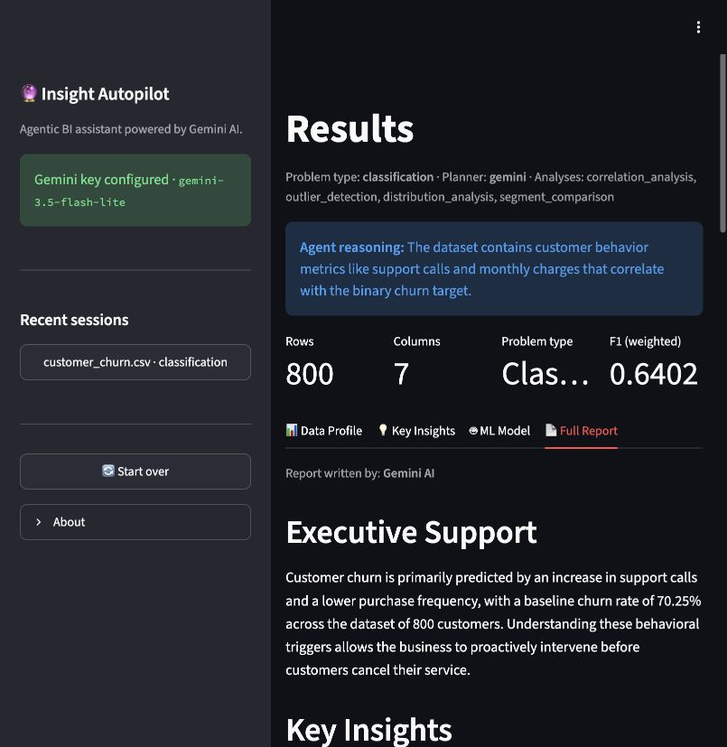

# Insight Autopilot



An agentic Business Intelligence assistant that turns structured data into actionable insights. Upload any dataset (CSV, Excel, or SQL) and ask a plain-English question — Insight Autopilot will profile the data, create an analysis plan using an AI agent, automatically select and train the right ML model, explain predictions, score the confidence of every insight, and generate a stakeholder-ready report.

**Tech Stack:** Python · Gemini (Google REST API) · scikit-learn · SciPy · Streamlit · Plotly · SQLite

This project uses **Gemini 3.5 Flash-Lite** through Google's REST API for planning and reporting. It also supports running completely offline (using a deterministic heuristic planner and template report writer) if no API key is provided.

---

## Features

1. **Robust Ingestion**: Loads data from CSV, Excel, or SQL via SQLAlchemy into a Pandas DataFrame.
2. **Automated Profiling**: Extracts column types, missingness, distributions, correlations, and infers likely prediction targets.
3. **Agentic Planning**: A Gemini-powered AI agent reads the dataset profile and the user's question, then structures an execution plan in JSON.
4. **Statistical Analysis**: Performs correlation analysis, outlier detection (Isolation Forest), distribution analysis, trend decomposition, and segment comparison (ANOVA).
5. **AutoML Pipeline**: Automatically selects regression, classification, or clustering models, builds leak-free scikit-learn pipelines, and cross-validates across algorithms.
6. **Plain English Explainability**: Translates complex ML concepts into business logic using permutation feature importance.
7. **Confidence Scoring (0-1)**: Assigns a confidence score to every insight based on data quality, statistical significance, and bootstrap stability.
8. **Automated Reporting**: A second Gemini call summarizes the findings into a business narrative (downloadable as HTML).
9. **Session History**: Persists past runs in a local SQLite database for easy retrieval.

---

## Quickstart

### 1. Environment Setup

Use Python 3.13 (recommended), or Python 3.10–3.12. Create a virtual environment and install dependencies:

```bash
cd insight_autopilot

# Create and activate virtual environment
python3 -m venv .venv
source .venv/bin/activate  # On Windows: .venv\Scripts\activate

# Install requirements
pip install -r requirements.txt
```

### 2. API Configuration

Create a Gemini API key in [Google AI Studio](https://aistudio.google.com/apikey), then configure it using either of the local methods below.

**Option A: `.env`**

```bash
cp .env.example .env
```
Open `.env` and replace the API key placeholder:
```env
GEMINI_API_KEY="your-gemini-api-key-here"
GEMINI_MODEL="gemini-3.5-flash-lite"
```

**Option B: Streamlit secrets**

Copy `.streamlit/secrets.toml.example` to `.streamlit/secrets.toml` and set:

```toml
GEMINI_API_KEY = "your-gemini-api-key-here"
GEMINI_MODEL = "gemini-3.5-flash-lite"
```

`GEMINI_API_KEY` enables the AI planner and report writer. `GEMINI_MODEL` is optional; its default is `gemini-3.5-flash-lite`. The app also accepts `GOOGLE_API_KEY` when `GEMINI_API_KEY` is absent. Use one key source to keep configuration clear; environment variables take precedence over Streamlit secrets for the same setting.

Both `.env` and `.streamlit/secrets.toml` are excluded from Git. Keep real API keys in those private files or Streamlit Cloud Secrets.

If no key is configured, the app uses its offline planner and template report writer. It also falls back to these if a Gemini request fails.

### 3. Generate Demo Data (Optional)

We include a lightweight script to generate sample datasets:
```bash
python scripts/generate_samples.py
```

### 4. Run the Dashboard

```bash
streamlit run app.py
```

---

## Testing

The test suite runs fully offline, even when a local API key is configured. It covers Gemini configuration and HTTP requests, ingestion, profiling, model selection, confidence scoring, storage, the Streamlit sidebar, and the end-to-end pipeline.

```bash
pip install pytest
pytest -q
```

---

## Deployment (Streamlit Cloud)

For a new Streamlit Community Cloud deployment:

1. Push this repository to GitHub.
2. Go to **share.streamlit.io** → **Create app** and point it to `app.py`.
3. In **Advanced settings**, select **Python 3.13** and add these **Secrets**:
   ```toml
   GEMINI_API_KEY = "your-gemini-api-key-here"
   GEMINI_MODEL = "gemini-3.5-flash-lite"
   ```

For an existing deployment, open **App settings → Secrets**, enter the same TOML, and click **Save changes**. Keep the two settings at the top level, above any `[section]`. Local secrets files are not uploaded through Git, so configure the deployed app's secrets separately.

The sidebar displays **Gemini key configured** when the key is loaded. A successful AI run displays **Planner: gemini** and **Report written by: Gemini AI**; the sidebar alone does not verify an API request.

Streamlit Cloud uses an ephemeral filesystem, so SQLite session history can reset on redeployment.

---

## License

This project is open-source under the MIT License. Built as an advanced portfolio project for Data Science and BI engineering roles.
